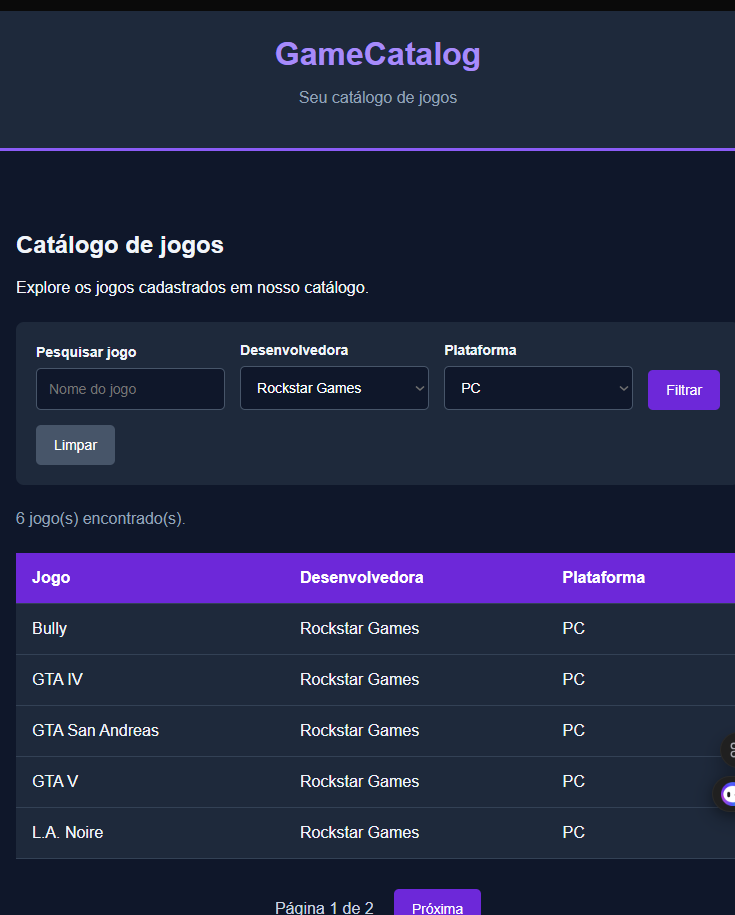

# GameCatalog — Catálogo de Jogos

## Integrantes

- Inácio
- Anderson

## Descrição

O GameCatalog é um sistema de catálogo de jogos desenvolvido com Django. O projeto tem como objetivo aplicar os conhecimentos de consultas ORM, pesquisa textual, filtragem e paginação de registros.

## Tecnologias utilizadas

- Python
- Django 5
- HTML
- CSS
- SQLite

## Funcionalidades

- Listagem de jogos cadastrados.
- Pesquisa textual pelo nome do jogo.
- Filtro por desenvolvedora.
- Filtro por plataforma.
- Combinação de pesquisa e filtros.
- Paginação com cinco jogos por página.
- Preservação dos filtros durante a navegação.
- Cadastro de registros pelo Django Admin.

## Banco de dados

O sistema possui três modelos relacionados: Jogo, Desenvolvedora e Plataforma.

O banco de dados contém 20 jogos, 5 desenvolvedoras e 3 plataformas.

## Como executar

Crie o ambiente virtual:

```powershell
python -m venv venv
```

Ative o ambiente virtual:

```powershell
.\venv\Scripts\Activate.ps1
```

Instale as dependências:

```powershell
pip install -r requirements.txt
```

Execute as migrações:

```powershell
python manage.py migrate
```

Inicie o servidor:

```powershell
python manage.py runserver
```

Acesse http://127.0.0.1:8000/

## Testes

Para executar os testes automatizados:

```powershell
python manage.py test
```

## Captura de tela

